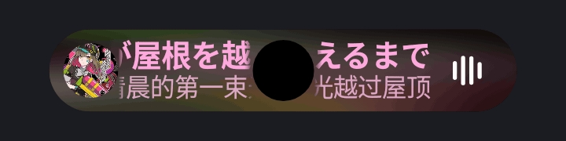
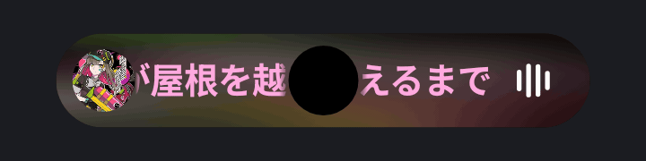
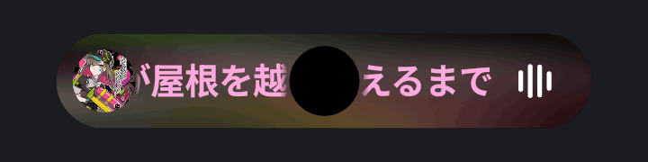
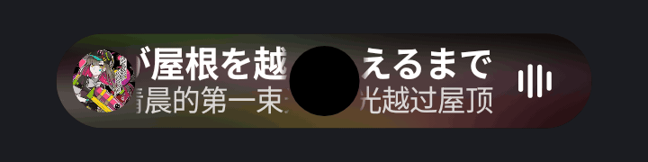

# Color Lyric 16

**Color Lyric 16** is an All-in-One LSPosed module for **ColorOS 16** (ported and expanded from [Luckyumimi/Color-lyric](https://github.com/Luckyumimi/Color-lyric)). It displays real-time synced lyrics directly inside the native ColorOS 16 **Fluid Cloud** (Media Seedling capsule), **Lock Screen**, and **Always-On Display (AOD)** — with a built-in multi-source online lyric engine, multi-language auto-translation, real-time tuning, no-lyric fallback, and blurred album art background.

> **Target OS:** ColorOS 16 (Android 16) with LSPosed API 102+ (also retains ColorOS 17 compatibility hooks).  
> **All-in-One:** No separate Bridge or external Lyric Provider apps are required. Everything runs inside a single module (`com.hungnopro.coslrc16`).

---

## Previews

<table>
  <tr>
    <th scope="col">Two-Line Lyrics + Translation</th>
    <th scope="col">Single-Line Lyrics</th>
  </tr>
  <tr>
    <td>
      <picture>
        <source type="image/webp" srcset="docs/previews/capsule-preview.webp">
        
      </picture>
    </td>
    <td>
      <picture>
        <source type="image/webp" srcset="docs/previews/capsule-preview-single-line.webp">
        
      </picture>
    </td>
  </tr>
  <tr>
    <th scope="col">Two-Line Original (Current + Next)</th>
    <th scope="col">Tint Off (Two-Line Translation)</th>
  </tr>
  <tr>
    <td>
      <picture>
        <source type="image/webp" srcset="docs/previews/capsule-preview-two-line-lyrics.webp">
        
      </picture>
    </td>
    <td>
      <picture>
        <source type="image/webp" srcset="docs/previews/capsule-preview-tint-off.webp">
        
      </picture>
    </td>
  </tr>
</table>

---

## What's New in Color Lyric 16 (All-in-One)

- **Native ColorOS 16 Fluid Cloud Port:** Hooks ColorOS 16's `MediaSeedling` / `OplusMediaSeedlingController` and `CapsuleContainer` / `CapsuleView`, aligning the artwork, waveform, and lyric canvas cleanly around the actual hardware punch-hole (`getBlankWidth()`).
- **Built-in Multi-Source Online Lyric Engine:** Automatically fetches synced lyrics when a media player does not supply them, with local disk caching and YouTube/MV track-title sanitization:
  - **Apple Music** (TTML word-by-word timing via iTunes Search + Paxsenix TTML)
  - **Better Lyrics** (TTML / synced lyrics)
  - **LRCLIB**
  - **Kugou**
  - **lyrics.ovh**
  - Selecting a specific provider sets it as the **preferred source**; if unavailable, the engine automatically falls back across remaining sources and prioritizes **word-synced** lyrics whenever available.
- **Built-in Multi-Language Auto-Translation:** Automatically translates synced lyrics into your preferred target language (13 choices including **System Language**, English, Vietnamese, Chinese, Japanese, Korean, Spanish, French, German, Russian, Thai, Indonesian, etc.) while preserving word-by-word TTML timings.
- **Lock Screen & AOD Lyrics Bridge:** Injects live synced lyrics into ColorOS 16's Lock Screen (`OplusMediaDataManagerEx`) and Always-On Display (`AodMediaViewHolder`) directly from the same module.
- **AOD All-Player Whitelist Unlock:** Optional toggle to bypass ColorOS 16's stock AOD media whitelist (which restricts AOD music/lyrics to Spotify by default), extending AOD support to any media player.
- **Live Hook Status Monitor:** The Home tab displays real-time hook status for **Fluid Cloud**, **Lock Screen**, and **Always-On Display**.
- **Real-Time Settings Sync:** Changes to lyric source, translation language, lock screen/AOD bridge, and visual tuning take effect immediately without restarting SystemUI.
- **Liquid Glass COUI UI & Custom Icon:** Clean ColorOS-native Liquid Glass interface with in-app update checking against this repository's GitHub Releases.

---

## Installation

1. Download the latest APK from [Releases](https://github.com/HungNoPro/Color-Lyric-16/releases).
2. Enable **Color Lyric 16** in LSPosed and select **`com.android.systemui` (System UI)** in the module scope. *(Fluid Cloud, Lock Screen, and AOD all live inside System UI, so only one scope is required.)*
3. Reboot your device or restart System UI (the in-app restart button in the top-right corner requires Root permission).
4. Open **Color Lyric 16**:
   - On the **Home** tab, verify that Fluid Cloud, Lock Screen, and AOD hooks are active, and configure your preferred **Lyric Source**, **Auto-Translation Language**, **Lock Screen / AOD Bridge**, and **AOD Whitelist Unlock**.
   - On the **Tuning** tab, customize typography, layout, color tinting, blur, and lyric behavior in real time.

---

## Tuning & Lyric Behavior Details

- **Word-by-Word Lyrics & Intro Countdown** (*Tuning → Lyric Behavior*, enabled by default):
  - When word-level timestamps are provided (e.g., Apple Music / Better Lyrics TTML), the highlight smoothly sweeps left-to-right across each glyph with a soft gradient edge.
  - Long lines wait until the highlight reaches the middle of the visible area to the right of the front camera before scrolling, stopping once the end of the line is fully visible.
  - With intro countdown enabled, recognizable song titles, artist credits, and copyright notices at the start of lyrics are skipped. Intros shorter than 3 seconds do not show countdown dots; instrumental interludes with clear time boundaries of at least 7 seconds also show three breathing dots. Short intros light up without scaling. Countdown dots animate on the right of the front camera while overflowing track info scrolls on the left. Transitions from dots/track info into lyrics follow your chosen line-switch animation.
  - Translation copyright notices and `//` placeholders are filtered out; instrumental-only notices follow your no-lyric fallback setting.
- **Whole-Character Camera Avoidance** (*Tuning → Camera Area*, off by default):
  - Can be toggled independently from edge fade blur. When enabled, lyrics to the right of the front camera start with a 2 dp inset; scrolling lyrics can enter this zone and softly fade if edge blur is enabled.
- **Line Switching:** Single-line mode switches when the current line finishes; two-line mode switches as the next line begins.
- **Dynamic Tinting & Background:** Lyrics are tinted by default using two representative colors extracted from the album artwork (configurable under *Tuning → Lyric Tint → Color Extraction*). Default sizes are 12 dp (first line) and 8 dp (second line); artwork blur defaults to 5 and dim to 0%.
- **Behavior When Paused** (*Tuning*): Keeps the module capsule style by default. Switching to **Restore Default** returns to the native ColorOS Fluid Cloud when music is paused and switches back automatically when playback resumes.

---

## Module Architecture

Source root: `app/src/main/java/shop/terramoor/github/io/`

| Directory / File | Responsibility |
| --- | --- |
| `settings/` | Liquid Glass COUI Home, Tuning, and About pages, live hook status UI, remote preference sync, live preview, JSON settings backup, and GitHub Releases update checker. |
| `lyrics/` | Reads `lyricInfo` from media sessions, parses LRC and TTML (line + word timings), runs the built-in multi-source `OnlineLyricFetcher` & `LyricBridgeProvider` with disk caching and multi-language translation, and generates lyric frames/transition boundaries. |
| `systemui/` | Hooks ColorOS 16 Fluid Cloud (`MediaSeedling`, `CapsuleContainer`, `CapsuleView`), Lock Screen (`OplusMediaDataManagerEx`), and AOD (`AodMediaDataListener`, `AodMediaViewHolder`), manages view ownership, draws lyrics/artwork blur, and restores native views when disabled. |
| `app/src/main/java/io/github/libxposed/service/` | LibXposed API 102 settings service entry validation. |
| `app/src/main/resources/META-INF/xposed/` | Module entry point and static `com.android.systemui` scope declaration. |
| `app/src/test/`, `app/src/androidTest/` | JVM unit tests and instrumented device tests. |

---

## Building from Source

Requirements: **Android SDK 37** and **JDK 25**.

```bash
# Build debug APK & run unit tests
./gradlew :app:assembleLocalDebug :app:testLocalDebugUnitTest

# Build release APK
./gradlew :app:assemblePublicRelease
```

---

## Diagnostics & Feedback

If lyrics do not appear or Fluid Cloud behaves unexpectedly:
1. Reboot your phone, play a track with known lyrics to reproduce the issue.
2. Open **About → Export Diagnostic Log** to save a `.txt` report (includes device/OS info, APK SHA-256, loaded LSPosed module version, current settings, and the latest 4096 hook/media/capsule/lyric events — song titles, lyric text, and session tokens are redacted).
3. Open an issue in [Issues](https://github.com/HungNoPro/Color-Lyric-16/issues) with the diagnostic report, your music player name/version, and any other System UI modules enabled.

---

## Credits & License

- **Upstream Original Project:** [Luckyumimi/Color-lyric](https://github.com/Luckyumimi/Color-lyric) — original ColorOS 17 Fluid Cloud lyric module, rendering engine, and COUI design.
- **ColorOS 16 Port & All-in-One Features:** [HungNoPro](https://github.com/HungNoPro) — ColorOS 16 `MediaSeedling` port, built-in 5-source online lyric engine, multi-language auto-translation, Lock Screen & AOD bridge, AOD whitelist unlock, and custom icon.
- [ColorOS Live Lyrics Bridge Icon](https://github.com/Andrea-lyz/ColorOS-Live-Lyrics-Bridge/blob/a51c946d1c66f02a6a4a96dc0f568e387fe05844/app/src/main/res/mipmap-xxhdpi/ic_launcher_round.png) and this project's source code are licensed under the **Apache-2.0 License**.
